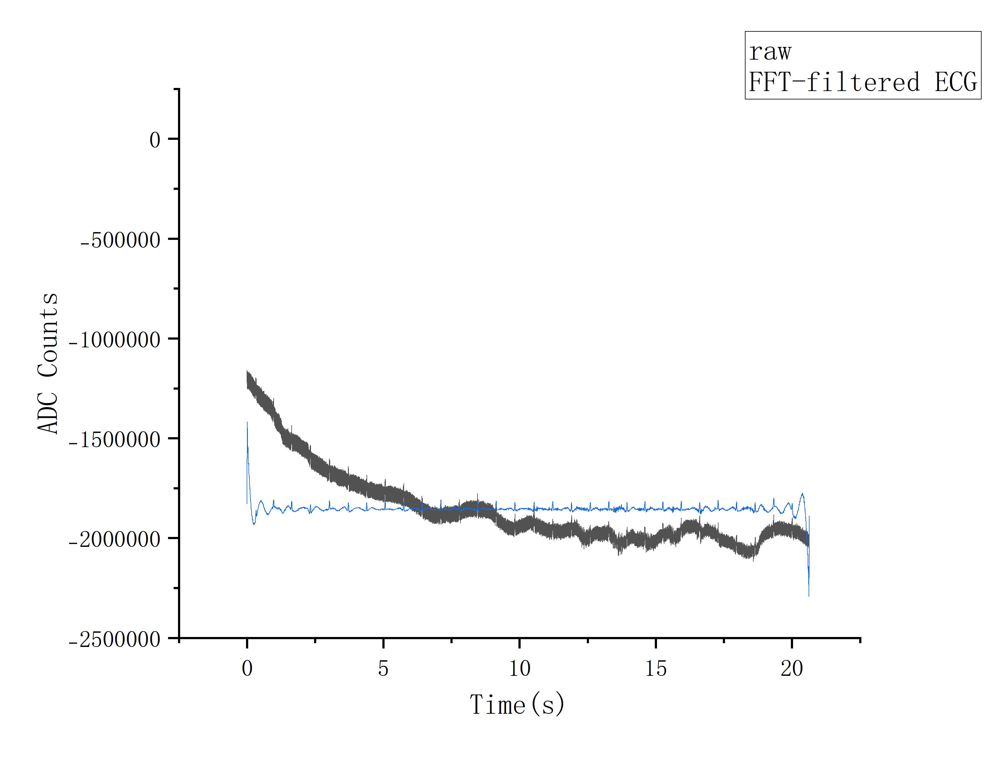

# Chen-EEG-BCI

An open-source experimental EEG acquisition system based on ADS1299 and STM32F405.

**Status: Hardware V1.0 — PCB fabricated, assembled, and under testing.**

## 1. Project Overview

The purpose of this project is to learn the complete development process of a bio-signal acquisition system, from circuit design and PCB fabrication to embedded firmware, signal acquisition, and signal processing.

Instead of directly using an existing EEG platform, I decided to design and build my own acquisition hardware to better understand the underlying principles of bio-signal acquisition.

The long-term goal is to use this hardware for EEG experiments and develop a basic brain-computer interface (BCI) system.

## 2. Hardware Design

### Main Components

| Module | Component |
|---|---|
| Bio-signal AFE | ADS1299 |
| Main Controller | STM32F405RGT6 |
| Motion Sensor | BMI270 |
| Wireless Module | E73-2G4M08S1CX |
| Storage | MicroSD Card |
| Power Management | TPS63070, MCP1754 |
| Power Source | 18650 Battery |

### Design Principles

The hardware is designed around the ADS1299, an 8-channel, 24-bit analog front end for bio-signal acquisition.

The STM32F405 acts as the main controller and communicates with the ADS1299 through SPI.

The PCB integrates several functional sections:

- Bio-signal acquisition and analog front end
- Microcontroller and peripheral interfaces
- Analog and digital power management
- Wireless communication
- Data storage
- Motion sensing

The board was designed in JLCEDA and manufactured by JLCPCB.

The first version focuses on learning the hardware design process and validating the basic acquisition architecture.

## 3. PCB Design and Assembly

### SCH Schematic
[View Schematic PDF](hardware/documentation/SCH_Schematic1.pdf)

### PCB Design


### Assembled PCB


*Hardware V1.0 — First attempt at designing and assembling a bio-signal acquisition PCB.*

## 4. Firmware and Data Acquisition

The firmware is developed using STM32CubeIDE and the STM32 HAL library.

The main firmware functions include:

- ADS1299 register configuration through SPI
- Data acquisition using the DRDY signal
- 24-bit ADC data parsing
- UART data transmission

The hardware has been used for preliminary ECG acquisition experiments.

### ECG Acquisition Results

The following figures show preliminary ECG data acquired using the custom hardware.

**Raw And FFT-filtered ECG Signal**



The raw data were imported into Origin for waveform visualization and preliminary FFT-based filtering.

- Sampling rate: 1000 Hz
- Processing software: Origin
- Filtering method: Origin built-in FFT filtering
- Processing type: Offline

The signal quality and acquisition stability still require further improvement.

## 5. Current Limitations

This is my first attempt at designing and manufacturing a bio-signal acquisition PCB. During hardware bring-up, several design issues were identified.

### Communication Interface

- The UART TX and RX connections were reversed in the PCB design.
- The USB D+ and D− data lines were connected with reversed polarity.
- The Bluetooth module does not have a reserved programming interface, making firmware programming and debugging less convenient.

These issues have affected the communication and debugging process.

### Hardware Validation

- The acquisition system is still under testing.
- ECG signals have been acquired, but baseline drift and environmental noise remain.
- EEG acquisition and full system validation are still in progress.

These issues will be considered in the next hardware revision.

## 6. Development Plan

### Hardware V1.0

- [x] System architecture design
- [x] Schematic design
- [x] PCB layout
- [x] PCB fabrication
- [x] Initial component assembly
- [x] Preliminary power-up and hardware testing
- [x] ADS1299 communication bring-up
- [x] Preliminary ECG acquisition
- [ ] Improve communication reliability
- [ ] Improve signal quality
- [ ] Validate stable EEG acquisition

### Hardware V2.0

The second PCB revision is currently being planned.

Potential improvements include:

- Correcting UART and USB communication connections
- Adding a programming interface for the Bluetooth module
- Improving PCB layout and power integrity
- Improving analog input and noise performance
- Refining electrode interfaces
- Integrating lessons learned from V1.0 testing

A head-mounted electrode system is also under development to support future EEG experiments.

## 7. Future BCI Development

The long-term goal is to build a motor imagery BCI system using the custom acquisition hardware.

The planned processing pipeline is:

```text
EEG Acquisition
       ↓
Signal Preprocessing
       ↓
Feature Extraction
       ↓
Classification
       ↓
Left / Right Motor Imagery
       ↓
Real-time Cursor Control
```

I have started exploring EEG preprocessing and motor imagery classification using Python and MNE-Python.

Future work will focus on improving the acquisition hardware, building a more systematic signal processing pipeline, and eventually implementing real-time BCI interaction.

## 8. Why This Project?

Building an EEG acquisition system from scratch is an opportunity to understand the entire process behind bio-signal acquisition.

Through this project, I aim to develop practical experience in:

- Analog front-end circuit design
- PCB design and hardware debugging
- Embedded systems and data acquisition
- Bio-signal processing
- Brain-computer interface development

This project is an ongoing learning and engineering effort. Hardware V1.0 represents my first attempt, and future revisions will be developed based on practical testing and debugging experience.

## 9. Disclaimer

This project is an experimental prototype for educational and research purposes.

It is not a medical device and is not intended for medical diagnosis or treatment.